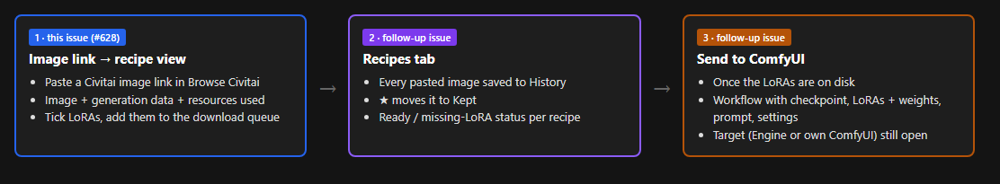
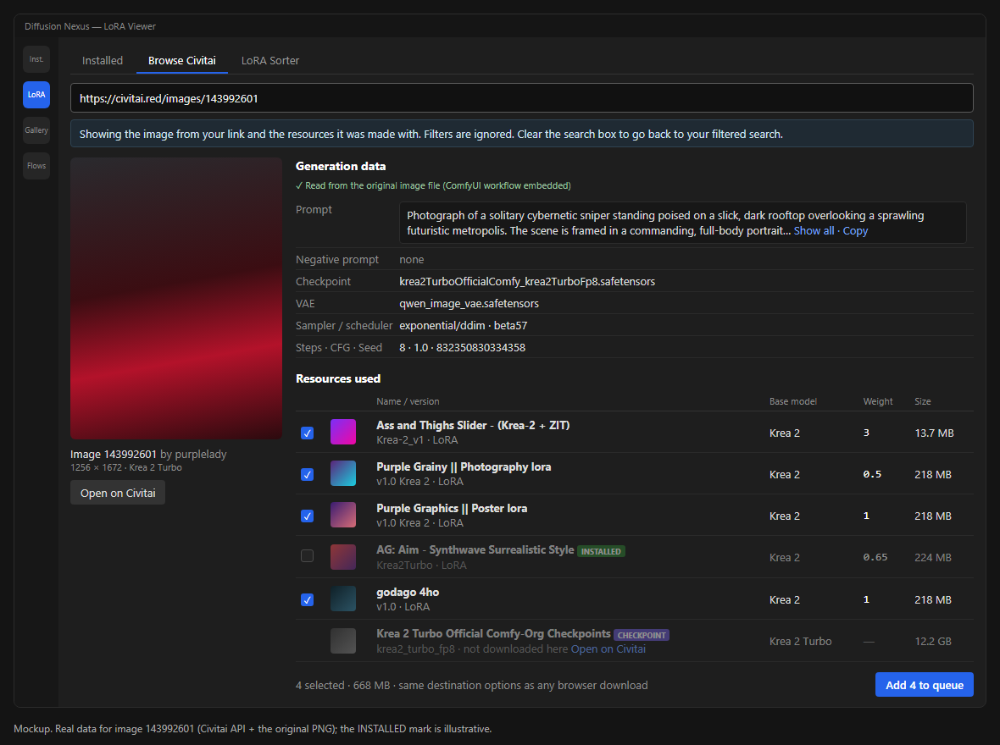
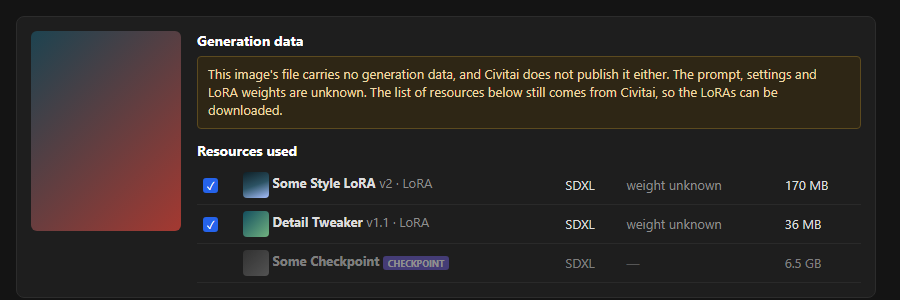
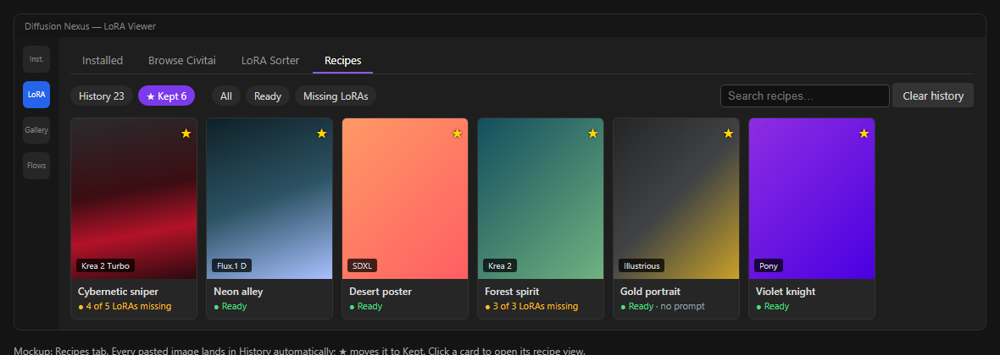

# Civitai image link → recipe view (#628)

Date: 2026-10-27 · Issue: #628 · Status: design approved for the recipe view; follow-ups listed at the end.

## Why

The owner sees an image on Civitai and wants to recreate it. Today that means opening every LoRA
from the image page, copying its link and downloading each one separately. The point of this feature
is **one paste for the whole set**, plus everything else needed to recreate the image (prompt,
settings, LoRA weights) shown in one place.

The idea grew into three pieces during the design session. **This issue delivers piece 1 only.**
Pieces 2 and 3 are separate issues so that each is delivered by one PR.

## Piece 1 (this issue): image link → recipe view

### Where it lives (decided)

The Browse Civitai search box in the LoRA Viewer. Since #630 every Civitai link pasted there
becomes results in the browser; an image link joins that path. The old Download LoRA dialog stays a
pointer to the browser and does not get its own image-link handling.

Accepted links: `civitai.com/images/<id>` and `civitai.red/images/<id>` (with or without `www.`,
`https://`, query string). Today `CivitaiLinkQuery` treats these as `IsLinkWithoutIds` and
`CivitaiLinkLookup` answers "That Civitai link does not point at a model"; an image id becomes a new,
third kind of link.

### What it looks like (decided: layout B, "with all the metadata")

Instead of the card grid, the browser shows one recipe view:

- **Left:** the image, its id, creator, size, base model, *Open on Civitai*.
- **Generation data:** prompt (collapsed, *Show all*, *Copy*), negative prompt, checkpoint file,
  VAE, sampler and scheduler, steps, CFG, seed. A one-line source note says where the data came
  from (for example "Read from the original image file (ComfyUI workflow embedded)").
- **Resources used:** one row per resource the image was made with: tick box, thumbnail, name,
  version, type, base model, **weight**, file size, and the same INSTALLED / EA / PAID badges the
  browser cards already show.
- **Footer:** "N selected · size" and *Add N to queue*.

The notice above it follows the #630 wording: showing the image from your link, filters are
ignored, clear the search box to go back.

When there is no generation data at all, the same view shows a warning in place of the settings,
and the resource list still works:

### Where the data comes from (researched 2026-10-27)

| Data | Source | Notes |
|---|---|---|
| Which resources were used | `GET /api/v1/images?imageId=<id>` → `modelVersionIds` | Always present. For the example image: 6 ids, matching the page's "Resources used". |
| Name, type, base model, size, files and hashes per resource | `GET /api/v1/model-versions/<id>` (existing `GetModelVersionAsync`) | One call per id, through the API gateway (rate limiting, 429). |
| Prompt, settings, LoRA weights | **The original image file** (`url` from the images call, which carries `original=true`) | The public API returned `meta = null` for **all 79 images sampled** (newest, all-time top, and images made with one of the example LoRAs). The web page's own endpoint (`/api/trpc/image.getGenerationData`) answers `401 – please use the public API`. So the file is the only usable source. |

What the 79 original files carried:

| Content | Share | Format |
|---|---|---|
| A1111/Forge style parameters text (`Steps: …, Sampler: …, Seed: …`, `Lora hashes`) | 72% (57) | PNG `parameters` text chunk, or JPEG EXIF (37 of the 57 were JPEG) |
| A full ComfyUI graph (`prompt` / `workflow` chunks) | 14% (11) | PNG only |
| Nothing | 18% (14) | |

The example image (143992601) is a PNG with both: the parameters text and the ComfyUI graph. Its
graph has an rgthree *Power Lora Loader* with 47 LoRA entries, of which **5 are switched on** (`"on": true`),
and their strengths are exactly the weights the web page shows: 3, 0.5, 1, 0.65, 1. Entries
with `"on": false` must be ignored.

### Behaviour (my calls unless marked)

- **Reading the file.** The app already has `ImageMetadataParser` + `PngChunkReader` (ComfyUI graph
  first, else A1111 `parameters`). It reads **PNG only**; reading the A1111 text from **JPEG EXIF**
  (UserComment) is part of this issue, because more than half of the files that carry parameters are
  JPEG. WebP was not seen in the sample; supporting it is optional.
- **The ComfyUI graph needs its own reader here.** The shared `ComfyUiPromptTracer` (used by the
  Metadata Distiller and Batch Upscale, a port of `tracer.py` in ComfyUI-AI2Go-Utils) starts only
  from the four core samplers (`KSampler`, `KSamplerAdvanced`, `SamplerCustom`,
  `SamplerCustomAdvanced`). The example graph uses RES4LYF's `ClownsharKSampler_Beta`, so the trace
  finds nothing, and `ImageMetadataParser.Parse` then returns "no data" without trying the
  `parameters` chunk the same file carries. Today the example image would show *no generation data*.
  My call: **do not change the shared tracer** (Distiller and Batch Upscale output stays as it is).
  The recipe view instead:
  1. takes prompt and settings from the graph trace when it succeeds, otherwise from the
     `parameters` text (the example's text has prompt, steps, sampler `exponential/ddim_beta57`,
     CFG, seed, size, model, VAE and `Lora hashes`, but **no weights**);
  2. collects LoRA weights with a separate scan of **every** LoRA loader node in the `prompt` chunk
     (the executed graph, so muted and bypassed nodes are already absent), wherever it sits: core
     `LoraLoader` / `LoraLoaderModelOnly` (`strength_model`) and rgthree *Power Lora Loader* entries
     with `"on": true` (`strength`). Entries with `"on": false` are skipped. A1111 `<lora:name:w>` tags in
     the prompt are the weight source for A1111/Forge files;
  3. says in the source note which one it used ("ComfyUI workflow" or "settings text").
  When graph and text disagree, the graph wins.
- **Matching weights to resources.** Each Civitai file lists several hashes (`AutoV1`, `AutoV2`,
  `AutoV3`, `SHA256`, `SHA256_12`, …). Match a weight to a resource by hash first, comparing a file
  hash against every hash kind Civitai lists (the example's `Lora hashes` are 10-character AutoV2:
  `Purple_Graphics_KR2: 990d0df641` = Civitai's AutoV2 `990D0DF641`; other tools write 12-character
  AutoV3 or SHA256_12, and `CivitaiFileHashes` has no `AutoV3` / `SHA256_12` field yet). Then match
  by file name (ComfyUI gives a path like `Krea2\Style\godago_4ho.safetensors`; Civitai gives
  `godago_4ho.safetensors`). A resource with no matching entry shows *weight unknown*.
- **Links only.** A bare number keeps its #630 meaning (model id and version id); it is not also
  tried as an image id.
- **Acceptance example.** Pasting `https://civitai.red/images/143992601` shows the prompt, the
  settings above and all five LoRAs with weights 3, 0.5, 1, 0.65, 1, and the checkpoint without a
  tick box.
- **LoRAs in the file but not on Civitai's list** (private or deleted LoRAs): shown as extra rows
  without a tick box, labelled "not linked on Civitai", so the recipe is complete.
- **Ticked by default:** every LoRA / LoCon / DoRA that is not installed.
- **Already installed** (decided in the session): shown with INSTALLED, not ticked. Use the
  browser's existing installed snapshot, same as link cards in #630.
- **Checkpoint** (my call; it answers the issue's open question): shown for information with
  *Open on Civitai*, **no tick box**. The browser's queue writes into the LoRA download destination,
  and a checkpoint does not belong there. Other non-LoRA types (VAE, embeddings, upscalers) are shown
  the same way.
- **Early access / paywalled:** same badges and the same queue/waitlist behaviour as a card.
- **Download:** the ticked versions go into `CivitaiDownloadQueue` with the usual destination options.
  Joining a running batch follows #604. One failed or gated LoRA does not stop the rest.
- **NSFW:** the image preview follows the same NSFW display rule as the browser's cards.
- **Video posts:** the resource list works the same; generation data is usually absent, so the
  no-metadata state applies.
- **Logging:** every step (link kind, API calls, file format found, how many weights matched, what
  went into the queue) goes to the Unified Console, per the standing rule.

### Goals / non-goals

Goals: one paste shows the image, its generation data and its LoRAs; one click queues the missing
LoRAs; the weights are visible wherever the file has them.

Non-goals for #628: saving recipes (piece 2), building or opening a ComfyUI workflow (piece 3),
scraping the Civitai web page or its internal endpoints, `/posts/<id>` links, downloading
checkpoints.

Anti-goal: a recipe view that **guesses**. When a value is not known it says so ("weight unknown",
"no generation data"); it never shows a default as if it came from the image.

### Left to the builder

Exact control layout and sizes in Avalonia, how the recipe view swaps with the card grid, caching
of the downloaded original (it is also the preview), test seams, and where the new parsing code
sits (UI vs Service project).

## Follow-ups (separate issues)

### Piece 2: Recipes tab

Decided in the session: a **Recipes** tab in the LoRA Viewer (next to Installed / Browse Civitai /
LoRA Sorter), not the Generation Gallery. Every pasted image lands in **History** automatically; ★
moves it to **Kept** (this is what "mark which images to archive" means). Each card shows whether
the recipe's LoRAs are all on disk (*Ready*) or how many are missing. Clicking a card opens the
recipe view. My call: a recipe is a folder on disk (image file + JSON with everything the recipe
view showed), not database rows.

### Piece 3: Send to ComfyUI

Once a recipe's LoRAs are on disk, one click builds a ComfyUI workflow (checkpoint, LoRAs with
weights, prompt, sampler settings) and opens it. When the file carries a full ComfyUI graph (14% of
the sample) that graph is the starting point, with model and LoRA paths remapped to local files.
**Open:** whether the target is the app's built-in Diffusion Nexus Engine, the user's own ComfyUI,
or both. Custom nodes in the source graph (the example uses RES4LYF's `ClownsharKSampler_Beta`,
rgthree, `SaveImageWithMetaData`) may be missing locally; how to handle that is part of that issue.
