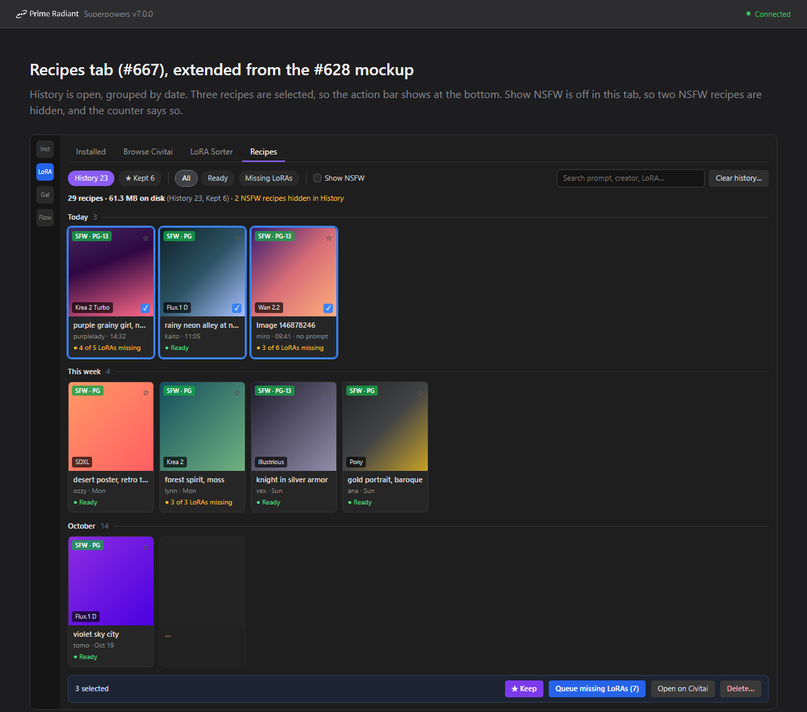

# Recipes tab (#667) — design

Date: 2026-10-28 · Issue: #667 · Milestone: Civitai image recipes · Builds on #628 (PR #666)

## Why

#628 turns a pasted Civitai image link into a recipe view in Browse Civitai: the image, its
generation data, the resources with weights, and one click to queue the missing LoRAs. Nothing is
kept. Leave the view and the recipe is gone. The owner pastes images over several days and later
**decides which ones to keep** ("think about what to archive"). The Recipes tab is where that happens:
every pasted image is there, grouped by when it was pasted, and the owner keeps, queues or deletes.

Success: a week after pasting a dozen images, the owner opens the tab, sees at a glance which
recipes are ready to run and which miss LoRAs, keeps the good ones, deletes the rest, and knows how
much disk space the whole collection takes.

## Mockup

Extended from the #628 mockup (`assets/2026-10-27-civitai-image-recipe/3-recipes-tab.png`). The
owner chose option A at the bottom: a recipe opens inside the Recipes tab.

## What the owner decided

| Topic | Decision (owner, 2026-10-28) |
|---|---|
| Place | A **Recipes** tab in the LoRA Viewer, after Installed / Browse Civitai / LoRA Sorter (#628 design session). |
| History | Every image link pasted into Browse Civitai lands in **History** automatically. |
| Kept | ★ (or **Keep** on a selection) moves a recipe to **Kept**; un-keeping moves it back. "Archive" means Kept. |
| Grouping | Newest first under date headers: **Today**, **This week**, then one header per month (**October**, **September**, …), like the gallery's date grouping. Kept is grouped the same way. No grouping by post (#668). |
| Card | Enough to decide without opening it: the image, the SFW/NSFW badge, Ready or "N of M LoRAs missing", and when it was pasted. |
| Selection and actions | Select one or more cards, as in the gallery, and act on them: keep, un-keep, delete, and more. |
| Delete | Only by hand. The app never deletes a recipe on its own. |
| Disk space | A counter shows how many recipes there are and how much disk space they take. |
| NSFW | The tab has **its own Show NSFW toggle**, independent of the LoRA Viewer's and Browse Civitai's, built like the other modules' toggles so that #629's app-wide switch can set it later. #629 itself is not part of this issue. |
| Opening a recipe | Clicking a card opens the #628 recipe view **inside the Recipes tab**, with a **Back** button that returns to the same place in the list, selection intact. |
| Pasted links | A pasted link ignores every filter and hides nothing (#628). An opened recipe likewise hides nothing, whatever the tab's toggle says. |

## Behaviour

### Top row

History (count) · ★ Kept (count) — switch between the two lists. All / Ready / Missing LoRAs.
Show NSFW. Search. **Clear history…**

- **Search** (my call) matches the prompt, the creator, the image id and the names of the LoRAs,
  case-insensitively, within the current list.
- **Show NSFW** (my call on the details): checked by default, like the LoRA Viewer and Browse
  Civitai; not saved between sessions until #629 decides the startup mode. Off hides the recipes
  `NsfwPolicy` judges NSFW (unrated counts as NSFW, as everywhere). Changing it is logged.
- **Clear history…** deletes every recipe in History after a confirmation that says how many
  recipes and how much disk space. It never touches Kept.

### Counter

"29 recipes · 61.3 MB on disk (History 23, Kept 6)". It counts **every recipe on disk**, History and
Kept together, so it does not jump when the list or a filter changes. When filters, search or Show
NSFW hide recipes in the current list, a note beside it says how many ("2 NSFW recipes hidden in
History"). The History and Kept chip counts are the totals of each list; each date header shows how
many recipes it shows. The size is what the recipe folders take on disk, recomputed after every
save or delete. (Counts must agree: the same unit and scope everywhere.)

### Date groups

Today (pasted since local midnight), This week (since the start of the current ISO week, Monday,
excluding today), then a header per calendar month in the current year ("October"), and month plus
year for earlier years ("December 2025"). Times are local. Within a group, newest first.

### Card

- The image (decoded small, as the browser's cards do).
- Top left: Civitai's rating badge, "SFW · PG" / "NSFW · X" (#628's `RatingBadge`).
- Top right: ★, filled when kept; clicking it toggles kept.
- Bottom left on the image: the base model.
- Title (my call): the start of the prompt, one line, ellipsised; "Image <id>" when there is no
  prompt.
- Second line: creator · paste time ("14:32" today, the weekday this week, the date before), plus
  "no prompt" when the recipe has generation data without a prompt or none at all.
- Status line (my call on the counting, held to the anti-goal "never Ready while a LoRA is missing"):
  - M is every LoRA the recipe uses: the LoRAs Civitai lists, plus the LoRAs the file names that
    Civitai does not list (#628's "not linked on Civitai"). N is those of them not installed. An
    unlinked LoRA counts as installed when its file hash is in the installed index, otherwise it is
    missing, and the line adds "(1 not on Civitai)" because it cannot be downloaded.
  - Early-access and paid LoRAs that are not installed are missing like any other.
  - A checkpoint or other non-LoRA is shown in the recipe but never queued (#628), so it does not
    count.
  - A resource whose load failed (429, network, "not found", "no longer available") has no known
    type. It is never counted as installed: the line says "**1 resource could not be loaded**"
    (amber) instead of Ready, alongside any missing count.
  - **Ready** (green) only when N is 0 and no resource failed to load. "No LoRAs" when M is 0 and
    nothing failed.
  - The Ready / Missing LoRAs filters use exactly this status: Ready shows the green cards, Missing
    LoRAs shows the amber ones.
  - The status follows the installed snapshot live: when a download finishes, the card turns Ready
    without a reload.
  - Opening a recipe retries its failed resources once in the background and saves what loads
    (my call); nothing retries on its own otherwise.
- Click opens the recipe; Ctrl-click and Shift-click select, as in the gallery.

### Selection bar

Shown while at least one card is selected: "N selected" · **★ Keep** (in Kept: **Un-keep**) ·
**Queue missing LoRAs (n)** · **Open on Civitai** · **Delete…**.

- **Queue missing LoRAs (n)**: the LoRAs of the selected recipes that are not installed, each
  version once even when several recipes use it, through the same queue path and pre-flight as the
  #628 recipe view (destination options, early access, paywall, #604 late joining). n is that
  de-duplicated count of what can be queued, so it can be lower than the cards' missing counts:
  LoRAs not on Civitai and resources that failed to load cannot be queued. The button's tooltip says
  how many of the missing LoRAs cannot be queued and why.
- **Open on Civitai**: opens each selected image's page (civitai.red for NSFW, #628's rule). More
  than 5 asks first (my call).
- **Delete…**: confirmation with the count and the disk space freed, then removes the recipes'
  folders.

### Opening a recipe

The grid is replaced by the #628 recipe view (`CivitaiRecipeView` / `CivitaiRecipeViewModel`), with
"← Back to History" (or Kept) above it. Its "Add N to queue" works as in Browse Civitai. Back
restores the list, scroll position and selection. The view shows the saved recipe straight away,
without going to Civitai, and works offline.

### Saving

- Every successful image-link load in Browse Civitai (#628) saves the recipe. A failed load ("no
  public image with ID …") saves nothing.
- Pasting an image that is already saved refreshes it from Civitai, moves it to the top of its list
  (paste time = now) and keeps its kept state. No second card. A refresh never makes a recipe worse
  (my call): a resource that loaded before but fails this time for a passing reason (429, network)
  keeps its saved record; a definite answer from Civitai ("not found", "no longer available")
  replaces it. Site data refused this time keeps the saved weights and data. When the reload fails
  as a whole (offline, or no longer public), the saved recipe stays as it is and does not move; the
  browser shows the saved recipe with a note that it could not be refreshed.
- Saving and deleting are logged to the Unified Console (standing rule), with the image id and the
  size.

## Storage (my call)

A recipe is a folder, not database rows:
`%LocalAppData%\DiffusionNexus\Recipes\<imageId>\` holding

- the original image file as #628 downloads it (`original.png|jpg|webp`; nothing for a video post), and
- `recipe.json`: a format version, the paste time, the kept flag, and everything the recipe view
  shows — Civitai's image record, the rating, the generation data (`ImageRecipeData`), the resources
  (version, model as Civitai returned them, the use with weights, any load error), the unlinked
  LoRAs and whether an API key was used.

The model records are stored so a recipe opens and queues offline; download URLs are Civitai's, so
queueing still needs the network. A folder whose JSON is missing or unreadable is shown as a broken
card ("Recipe could not be read") that can be deleted, never silently skipped (my call on the
details): it is listed in History, because its kept state is unknown; it counts in the counter
(its disk space is real) and in the History chip; it is deleted only by selecting it and choosing
Delete…, never by Clear history…, which could otherwise remove a recipe the user had kept.

#628's cache folder (`%LocalAppData%\DiffusionNexus\Cache\civitai-recipes`) is replaced by this
store: #628's service downloads the original into the recipe folder. Nothing is imported from the old
cache (owner, 2026-10-28: it only holds test pastes); the Recipes tab starts empty and the old folder
is left untouched.

## Goals / non-goals

Goals: every pasted image is kept until the user deletes it; a glance tells which recipes are ready;
keep, queue and delete work on a selection; the disk space is visible.

Non-goals: post links (#668), Send to ComfyUI (#665, its button stays disabled in the recipe view),
the app-wide NSFW switch (#629), grouping by post or by named collections, automatic deletion,
editing a recipe, importing recipes from anywhere but Browse Civitai.

Anti-goals: a counter that disagrees with the list; a recipe that disappears without the user
deleting it; a card that says Ready while a LoRA is missing.

## Left to the builder

Control layout and sizes in Avalonia, the date grouper (the gallery's grouping code is tied to its
own item types, so a small pure grouper for recipes is fine), list virtualization, thumbnail
decoding and caching, JSON serialization details, test seams, how the Recipes view model reaches the
browser's queue path, and where the store code lives (UI vs Service project).

Branching: #667 is built on `feature/recipes-tab-667`, cut from the #628 branch because it changes
#628's cache. Its PR targets `develop` once PR #666 is merged (retargeted if it is opened earlier).
